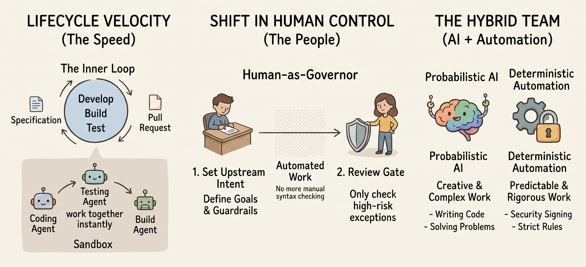

.. rst-class:: cover-top

.. raw:: html

    
    <h1>DevSecOps Practices</h1> <!-- manual title because raw html won't accept rst substitution -->
    <h2>Example Implementation 3 (Using Agentic SI)</h2>

=============================================================================
DevSecOps Practices: Example Implementation 3 (Using Agentic SI)
=============================================================================

**Scope**
~~~~~~~~~~~~~~~~~~~~~~~~~~~~~~~~~~

Readahead for October 28 Webinar: NCCoE DevSecOps and the Impact of Agentic Super Intelligence (SI)
^^^^^^^^^^^^^^^^^^^^^^^^^^^^^^^^^^^^^^^^^^^^^^^^^^^^^^^^^^^^^^^^^^^^^^^^^^^^^^^^^^^^^^^^^^^^^^^^^^^

Following the successful completion of Example Implementations 1 and 2 using Generative Super Intelligence (SI), the NCCoE is now scoping a third
implementation. Example Implementation 3 will demonstrate modernized DevSecOps practices using Agentic SI.

Traditional Software Development Lifecycle (SDLC) models within DevSecOps typically follow a sequential flow: Plan, Develop, Build, Test, Release, Deploy, and
Operate. In these models, developers write code and submit pull requests via human-paced processes reliant on manual or deterministic inspections. As Agentic SI
matures, enterprises are deploying agents to automate these processes. The introduction of agents creates three fundamental structural shifts across the SDLC as
shown below: 

*Note: SI-generated diagram using Gemini*

1. **Lifecycle velocity:** The Develop, Build, and Test phases converge into a high-velocity, machine-paced "inner loop." When a developer provides a
   specification or remediation goal, specialized agents (Coding, Testing, and Build agents) concurrently synthesize code, write security probers, and execute
   sandboxed trial builds before a human ever reviews the pull request.

2. **Shift from "human-as-operator" to "human-as-governor":** Human engineers are shifting away from executing repetitive operational tasks or inspecting every
   line of machine-generated syntax. Instead, humans operate at two critical control points:

   -  Upstream Intent and Policy Definition (Plan): Defining specifications, security guardrails, and risk thresholds.

   -  Risk-Triggered Escalation Gates (Release/Deploy): Evaluating high-consequence exceptions flagged by deterministic policy engines.

3. **Probabilistic agents are now deployed alongside deterministic automation:** While Agentic SI is uniquely powerful for open-ended synthesis, root-cause
   diagnosis, and code generation (probabilistic workflows), it is not required for every use case. Deterministic automation is sufficient for tasks requiring
   predictability and rigor, such as cryptographic signing, Software Bill of Materials (SBOM) generation, SLSA build provenance, and deploy-time admission
   control.

To demonstrate these structural shifts in the SDLC, the team will build the implementation around two looping workflows:

-  **The Inner Loop (Develop, Build, Test):** Agents operate within isolated cloud sandboxes, leveraging approved Model Context Protocols (MCP) and Skills to
   perform tasks such as analyzing repositories, generating code, initiating tests, and initiating pull requests. Humans govern these agents by defining intent
   and reviewing escalations. Deterministic automation enforces branch protection and executes tests, security scans and policy checks.

-  **The Outer Loop (Release, Deploy, Operate):** Policy-based escalation gates ensure human approval for high-risk changes, while deterministic automation
   handles release management, deployment orchestration, artifact signing, policy enforcement, and logging. Continuous runtime detection, container scanning,
   and Cloud Security Posture Management (CSPM) trigger agentic triage activities. Agents perform security scanning, vulnerability assessments, reproduce
   issues, generate patches, and prioritize remediations.

In this example implementation, **humans** dictate objectives, architecture, and risk tolerance; **Agentic SI** decomposes goals, selects tools, and executes
permitted actions; and **deterministic automation** provides the repeatable operations and enforcement required for compliance, signing, testing, and deployment
gating.

**Focus on Identity Capabilities:**

The project will prioritize identity capabilities, aligned to a broader Zero Trust strategy shown below:

-  Agentic identity:

   -  Will need to bind workload identity, operating instance, and active authority.

   -  Requires distinct non-human identities to differentiate agents from human users.

-  Persistence and ephemerality:

   -  Stable hardware/software trust anchors bound to underlying runtime environment (SPIFFE/SPIRE).

   -  Highly ephemeral, task-scoped credentials feature auto-expiration and attenuation.

-  Task scoped and contextual authorization:

   -  Shifts from static inherited permissions to dynamic, continuous Zero-Trust evaluation.

   -  Evaluates authorization at tool call/moment of action to limit blast radius and privilege escalation.

-  Auditability beyond action logging:

   -  Captures reasoning context, decision policies, delegations, and intent alongside actions.

   -  Implements tamper-evident, verifiable evidence chains and cryptographic receipts.

-  Delegation and accountability:

   -  Preserves authorization context across multi-hop, cross-domain agent chains.

   -  User signed tokens conveying delegation scope, constraints, and audit evidence.

-  Deterministic vs. probabilistic authorization:

   -  Deterministic authorization is a priority.

   -  Probabilistic (LLM-generated) information as a contextual risk signal.

Additional resources will be released on a rolling basis via the DevSecOps live document. As a next step, the project team will be developing notional
architecture diagrams for both the agents and the components needed to secure them in the SDLC.
